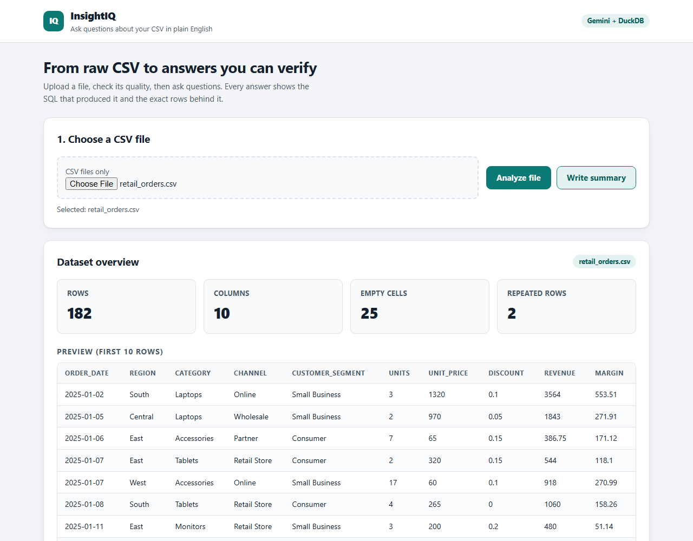
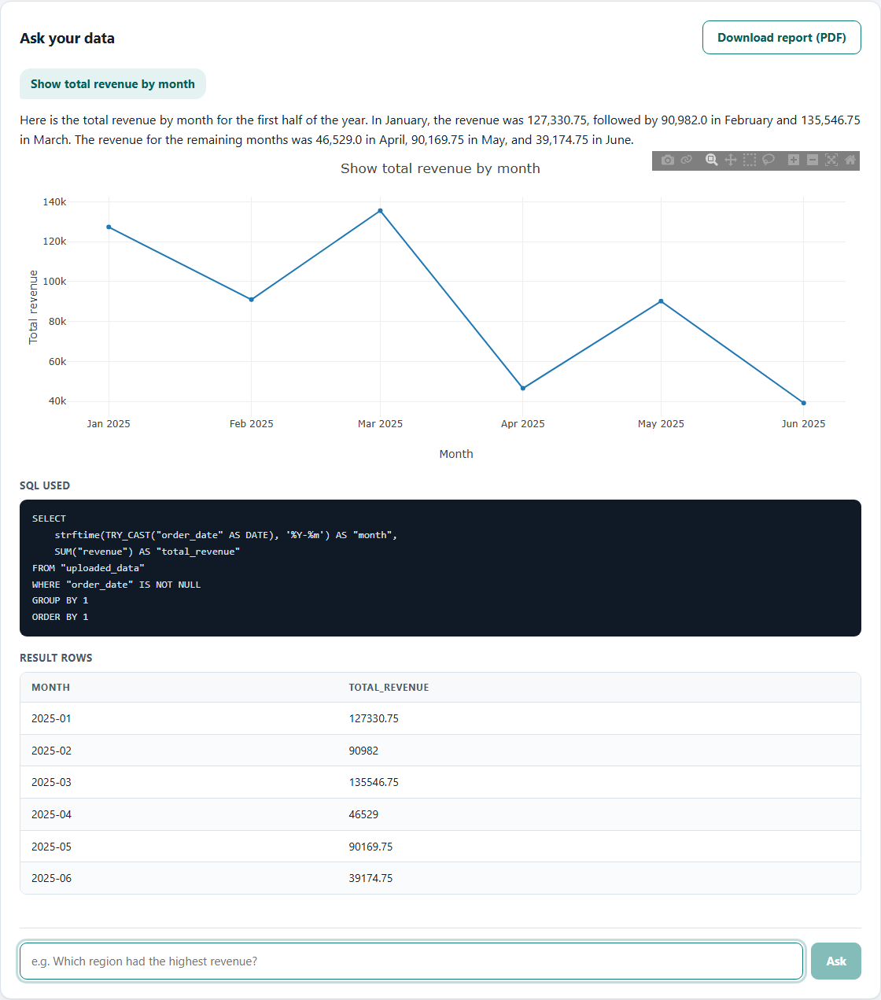
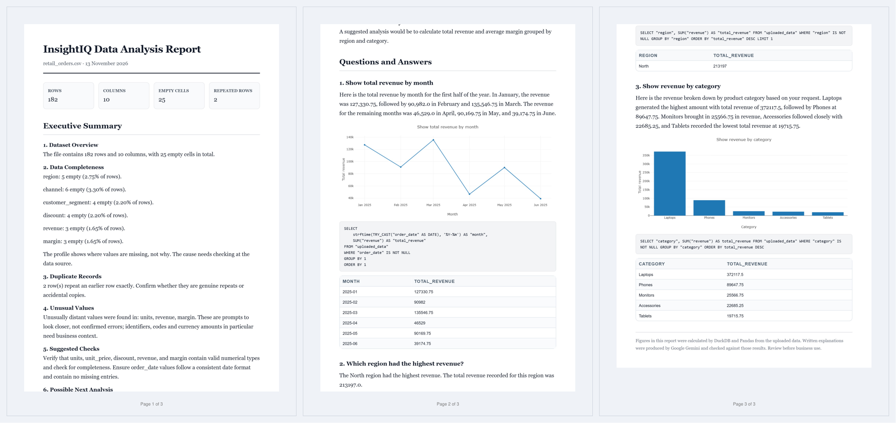

# InsightIQ – AI Data Analyst

A conversational data analytics app. Upload a CSV, see how healthy the data is, then ask questions in plain English. InsightIQ writes the SQL, checks it, runs it on DuckDB, and explains the real result with a chart, the SQL it used, and the exact table.

**The core idea: the AI never supplies the numbers.** Gemini writes SQL and explains results, but every figure comes from DuckDB or Pandas, and the code checks that the explanation only repeats numbers that really appear in the result.

---

## Screenshots

**Dataset health check** – counts, missing values, duplicates, types, statistics and outliers:



**A question answered** – a verified explanation, an interactive chart, the exact SQL, and the result table:



**The PDF report** – dataset facts, AI summary, and every question with its chart, SQL and rows:



---

## Engineering highlights

- **Safe by design:** AI-written SQL is treated as untrusted input. A parser-based validator allows one read-only `SELECT` on the uploaded table, and DuckDB itself runs with file access disabled.
- **Grounded answers:** Gemini writes SQL and explains results, but every number comes from DuckDB or Pandas. The code verifies that the explanation only repeats numbers from the result, and falls back to a Python-written sentence if it does not.
- **Self-correcting queries:** if the generated SQL fails, the error goes back to the model once for a corrected attempt.
- **Predictable charts:** chart type is chosen by tested rules from the shape of the result, not by the AI.
- **Upload once:** validated uploads, a server-side dataset store and proper HTTP status codes.
- **Tested:** 126 backend and 48 frontend tests, with Gemini replaced by fakes so they run offline.

---

## Features

- **Dataset health check:** row/column counts, missing values, duplicate rows (with examples), column types, numeric statistics (min, quartiles, median, mean, std) and outlier flags with the actual values.
- **AI executive summary:** facts are computed in Python; Gemini only adds suggested next checks.
- **Ask questions in English:** "Which region had the highest revenue?", "Show total revenue by month", "Which category is declining?".
- **Every answer shows its work:** the explanation, an interactive chart, the exact SQL, and the result table.
- **Full PDF report:** summary plus every question asked, with charts.

---

## How one question is answered

```
React question box
      │  POST /datasets/{id}/ask { question }
      ▼
FastAPI ── looks up the stored DataFrame
      │
      ▼
sql_agent.py   builds a schema description (types, category labels, ranges – not raw rows)
      │         and asks Gemini for ONE SQL query
      ▼
sql_validator.py   parses the SQL; only a single read-only SELECT on the uploaded table is allowed
      │            (on failure: the error goes back to Gemini for one corrected attempt)
      ▼
query_engine.py   runs it on an in-memory DuckDB with file access disabled
      │
      ├──► charts.py        picks a chart from the SHAPE of the result (rules, not AI)
      └──► interpreter.py   Gemini explains the real rows; code verifies every number
      ▼
JSON: explanation, sql, columns, rows, chart, attempts  ──►  React renders it
```

---

## Architecture and tech stack

| Layer | Technology | Why |
|---|---|---|
| Frontend | React 19, Vite, Axios, Plotly.js (basic bundle), html2pdf.js | Fast dev loop; Plotly is lazy-loaded so the first page stays light |
| Backend | Python, FastAPI, Pydantic | Typed requests and responses, automatic `/docs` |
| Data | Pandas, NumPy, DuckDB | Pandas for profiling, DuckDB for fast SQL on the uploaded data |
| AI | Google Gemini (`google-genai`) | One call site, model chosen by `GEMINI_MODEL` |
| SQL parsing | sqlglot | Checks the *structure* of generated SQL |
| Charts | Plotly (Python builds the figure, React draws it) | Chart decisions live in one tested place |
| Tests | pytest, Vitest, React Testing Library | |

---

## Safety and trust design

**Generated SQL is untrusted input.** Two independent layers:

1. `sql_validator.py` parses the SQL and rejects anything except one read-only `SELECT` (or `WITH ... SELECT` / `UNION`) on the uploaded table. It blocks writes and DDL, table functions such as `read_csv(...)`, environment and file functions, unknown tables and unknown columns.
2. `query_engine.py` runs the query on a fresh in-memory DuckDB connection with `enable_external_access=false` and a locked configuration. Even a trick that slipped past layer 1 cannot read server files.

**The AI cannot invent results.** `interpreter.py` extracts every number from Gemini's explanation and checks it against the result rows (ordinary rounding and counts of visible rows are allowed). One rewrite is allowed; after that a plain sentence written by Python is used. The table and SQL are always the exact result.

**Other safeguards:** upload type, size (default 10 MB) and encoding checks; proper HTTP status codes (400, 404, 413, 422, 502, 503); CORS limited to the configured frontend origins; API key only in `backend/.env`; internal errors logged server-side, never returned to the browser.

### What leaves your machine

Gemini receives: column names and types, missing counts, labels of category-like columns (few distinct values that repeat), min/max ranges, any SQL error text (truncated), and **up to 20 result rows** when it writes an explanation. Raw values from columns where most values are unique (names, IDs, free text) are not sent in the schema, but a question like "show all customers" returns real rows to the explanation step. Do not use sensitive or regulated data.

---

## Run it locally

You need Python, Node.js and a Gemini API key from [Google AI Studio](https://aistudio.google.com/). Developed and tested on Windows 11 with Python 3.14 and Node 24; other recent versions are likely fine but untested.

### 1. Backend

```bash
cd backend
python -m venv .venv
# Windows:   .venv\Scripts\activate
# macOS/Linux: source .venv/bin/activate
pip install -r requirements-dev.txt
cp .env.example .env        # then put your key in .env:  GEMINI_API_KEY=...
python -m uvicorn main:app --reload
```

API docs: http://127.0.0.1:8000/docs

### 2. Frontend

```bash
cd Frontend
npm install
npm run dev
```

Open http://localhost:5173 and upload `sample-data/retail_orders.csv`.

> **Port note:** the backend only accepts requests from the origins in `FRONTEND_ORIGINS` (default `http://localhost:5173,http://127.0.0.1:5173`). If Vite starts on another port, add it to `backend/.env`.

### Configuration

| Variable | Where | Default | Purpose |
|---|---|---|---|
| `GEMINI_API_KEY` | `backend/.env` | none (required) | Gemini access; never sent to the browser |
| `GEMINI_MODEL` | `backend/.env` | `gemini-3.5-flash-lite` | Model used for SQL and explanations |
| `MAX_UPLOAD_MB` | `backend/.env` | `10` | Upload size limit |
| `FRONTEND_ORIGINS` | `backend/.env` | localhost:5173 | Allowed browser origins (comma-separated) |
| `VITE_API_URL` | `Frontend/.env` | `http://127.0.0.1:8000` | Backend address |

---

## API

| Endpoint | Purpose |
|---|---|
| `GET /health` | Liveness check |
| `POST /datasets` | Upload a CSV (multipart). Returns `dataset_id`, preview, profile and outlier report |
| `POST /datasets/{id}/summary` | AI executive summary of the dataset |
| `POST /datasets/{id}/ask` | `{question}` → explanation, SQL, rows, chart and attempt count |

Errors use real status codes: 400 wrong file type, 404 unknown dataset, 413 file too large, 422 unreadable file / blocked SQL / invalid question, 502 Gemini unavailable, 503 API key missing.

---

## Tests

```bash
cd backend  && python -m pytest -q     # 126 tests: SQL validator, DuckDB lockdown, API, profiling, summary, charts, explanations
cd Frontend && npm test                # 48 tests: API client, chat, answers, report, full app flows
```

Gemini is replaced by fakes in the tests, so they run offline and for free.

---

## Project structure

```
backend/
  main.py            FastAPI routes and error mapping
  config.py          settings from environment variables
  schemas.py         Pydantic request/response models
  dataset_store.py   in-memory storage of uploaded DataFrames
  profiler.py        row/column stats, missing values, duplicates, types
  anomalies.py       z-score outlier detection
  llm.py             the single place that calls Gemini
  summary.py         executive summary: facts from Python, advice from Gemini
  sql_agent.py       schema context, prompt, generate -> validate -> run -> retry
  sql_validator.py   parser-based SQL safety checks
  query_engine.py    locked-down DuckDB execution
  interpreter.py     explanation + number verification
  charts.py          chart selection and Plotly figures
  tests/
Frontend/src/
  App.jsx            state and actions
  api.js             all backend calls
  pdf.js             PDF export
  styles.css         design tokens and styles
  components/        Header, UploadPanel, OverviewPanel, SummaryPanel, ChatPanel,
                     AnswerTurn, ChartView, ReportDocument, DataTable, SummaryText
  __tests__/
sample-data/retail_orders.csv     synthetic demo data (see below)
scripts/generate_sample_data.py   regenerates it
```

### Sample data

`sample-data/retail_orders.csv` is synthetic and reproducible (`python scripts/generate_sample_data.py`). It deliberately contains what the app is built to handle: missing values in several columns, two exact duplicate rows, three unusually large enterprise orders, a few loss-making orders, and a category (Accessories) whose share of orders declines over the six months.

---

## Known limitations

- **Datasets live in server memory.** They disappear on restart and are not shared across multiple server processes. A real deployment would use a database or object storage.
- **The explanation check verifies numbers, not meaning.** If Gemini names the wrong region but quotes correct numbers, the check cannot tell. The table and SQL are always shown next to the text for that reason.
- **Outliers use z-scores,** which a large outlier can mask. An IQR method would be more robust.
- **The PDF is image-based** (text is not selectable) and a heading can end up at the bottom of a page.
- **Gemini's SQL varies between runs,** even at temperature 0, so the same question can produce slightly different queries.
- **No authentication or rate limiting.** Intended as a single-user portfolio app.

## Roadmap

Deployment (Vercel for the frontend, Render or similar for the backend) and, later, LangGraph for multi-step analysis.
